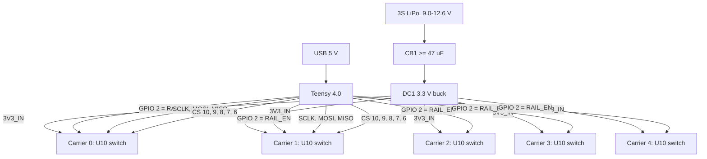
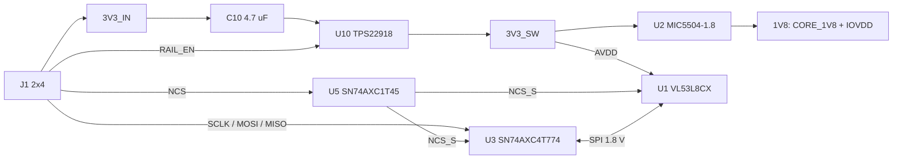

# VL53L8CX × 5 — ToF carrier array for Teensy 4.0

Five identical carrier boards, each carrying one ST **VL53L8CX** 8×8 multizone
Time-of-Flight sensor, wired to a **Teensy 4.0**. Every carrier level-shifts
3.3 V ↔ 1.8 V locally, so the host sees a plain 3.3 V SPI bus and the sensors
see only their 1.8 V I/O domain.

The array is read as a live **CSV stream over USB serial**: one timestamp and
five centre-zone distances, 15 times per second.

```
ms,S0,S1,S2,S3,S4
1234,512,488,-1,1203,497
```

`-1` means "no fresh valid target" for that sensor (no frame, no target, or a
demoted sensor). Everything else is millimetres.

| | |
|---|---|
| Sensor | VL53L8CX — 8×8 zones, 940 nm VCSEL, 45°×45° FoV (65° diagonal), up to 400 cm |
| Host | Teensy 4.0 (i.MX RT1062, 600 MHz) |
| Sensors | 5 |
| Frame rate | 15 Hz, continuous ranging |
| Host bus | SPI mode 3 @ 3 MHz, one CS per sensor |
| Sensor rail | 3.3 V AVDD, 1.8 V CORE/IOVDD, local LDO per board |
| External rail | 3.3 V, **≥ 1.5 A**, switched, separate from the Teensy |
| Typical / peak current | 465 mA / 750 mA on the external rail |
| Frame size | 320 B (trimmed from 1444 B) |
| Status | Design **Rev 9** (per-carrier load switch, 3S→3.3 V buck), review loop converged; round-11 verification 47 PASS / 10 NV / 0 FAIL; pre-layout audit: 0 FAIL, all findings closed |

> **The Teensy's own 3.3 V pin (~250 mA) never powers the array.** When the
> array is on, J1 carries `3V3_IN` from a separate 3S→3.3 V buck. The two 3.3 V
> rails share only GND.

---

## 1. System overview



Each carrier carries **its own load switch (U10)**, so the five rails come up and
fall together but are switched locally. That switch is the **only** way the
sensors are powered down. Because it sits on the carrier, it removes **AVDD and
the 1.8 V rail together** — the only sequence DS14161 allows — and the drop is
~5 mV instead of 40–80 mV. A single 100 kΩ (R10) at the host holds `RAIL_EN` low,
so the rail is **off at every Teensy reset**; firmware raises it as the first
action of `setup()`.

### Per-carrier block diagram



**The OE → NCS_S scheme is the heart of the carrier.** U3's output enable is
driven by the board's own `NCS_S`, and `NCS_S` is produced by U5 — not by U3.
So NCS low → that board is selected → its U3 turns on → its MISO drives the
shared bus. NCS high → U3 is Hi-Z → MISO released. Routing NCS through U3
would deadlock the board (it could never be selected). Only one MISO driver is
ever active.

---

## 2. Components

### 2.1 Per carrier board (×5 identical, 22 SMD parts each)

| Ref | Part | Package | Purpose |
|---|---|---|---|
| U1 | VL53L8CXV0GC/1 (with liner; liner removed after reflow) | LGA-16, 6.4 × 3.0 × 1.75 mm | The sensor. SPI mode; LPn and C1 `SPI_I2C_N` pulled up on board |
| U2 | MIC5504-1.8YMT | DFN-4, 1.0 × 1.0 mm | 1.8 V LDO: CORE_1V8 + IOVDD + VCCA of U3/U5. EN tied to IN |
| U3 | SN74AXC4T774RSVR | UQFN-16, 2.6 × 1.8 mm | SCLK / MOSI / MISO translator, **OE = NCS_S**, DIR1/2/3 = GND, DIR4 = 1V8 |
| U5 | SN74AXC1T45DTQR | X2SON-6, 1.0 × 0.8 mm | NCS translator. **DIR = GND ⇒ B→A** (3.3 V host drives 1.8 V sensor) |
| U10 | TPS22918TDBVRQ1 | SOT-23-6, 2.9 × 1.6 mm | Local rail switch: `3V3_IN` → `3V3_SW`. **CT open, no footprint; QOD tied to VOUT; ON = RAIL_EN** |
| C1 | 4.7 µF X5R 10 V | 0402 | AVDD at sensor pin C4, on `3V3_SW` (check DC-bias derating, else 0603) |
| C2 | 100 nF | 0402 | CORE_1V8 at B7 |
| C3 | 100 nF | 0402 | IOVDD at A3 |
| C4 | 100 nF | 0402 | U3 VCCA |
| C5 | 100 nF | 0402 | U3 VCCB |
| C6 | 2.2 µF X5R 10 V | 0402 | 3V3 at U2 input |
| C7 | 1 µF X5R 10 V | 0402 | U2 output (auto-discharged by the MIC5504) |
| C8 | 100 nF | 0402 | U5 VCCA |
| C9 | 100 nF | 0402 | U5 VCCB |
| C10 | 4.7 µF X5R 10 V | 0402 | U10 input reservoir on `3V3_IN` (TPS22918 needs C_IN ≥ 1 µF) |
| R1 | 47 kΩ | 0402 | NCS_S → IOVDD |
| R2 | 47 kΩ | 0402 | INT → IOVDD (INT is not routed to the host) |
| R3 | 47 kΩ | 0402 | SYNC → IOVDD |
| R4 | 47 kΩ | 0402 | LPn → IOVDD |
| R5 | 47 kΩ | 0402 | SPI_I2C_N → IOVDD (selects SPI) |
| R6 | 6.8 kΩ | 0402 | SCLK_S → 1V8. Holds SCLK at its mode-3 idle level so selecting the board cannot create a spurious clock edge |
| R7 | 4.7 kΩ | 0402 | NCS_H → `3V3_SW` (**switched** rail). Keeps every board deselected while the host is in reset |
| J1 | PH2-08-UA (Adam Tech), straight 2×4 | THT 2×4, 2.54 mm pitch and row spacing, 1.02 mm holes | 3V3_IN, GND, GND, SCLK, MOSI, MISO, NCS, RAIL_EN |

### 2.2 System BOM (outside the carriers)

There is **no separate power board**. The load switch lives on each carrier, and
the only external power part is the buck module that makes 3.3 V from the 3S
battery.

| Ref | Part | Value / notes | Qty |
|---|---|---|---|
| DC1 | Pololu **#5266** (APM81815, 3.3 V) | **The actual 3.3 V source.** 3S in (9.0–12.6 V), 1.1 A at 48 V in and more at 3S, 2 % accuracy, soft-start, ~1 g, 10.2 × 19.1 × 3.2 mm. **No reverse-voltage protection** | 1 |
| R10 | 100 kΩ | `RAIL_EN` → GND at the host. One resistor covers all five switches; the TPS22918 has no internal pull-down | 1 |
| CB1 | ≥ 47 µF, ≥ 25 V | At the **DC1 input** (battery side) for LC-spike suppression | 1 |

A machine-readable version of both tables is in `pcb design/BOM.csv` (one file,
carrier and system rows).

### 2.3 Why these parts

- **TPS22918TDBVRQ1** (AEC-Q100, SOT-23-6 DBV) — 2 A, 53 mΩ typical, **one
  per carrier** between `3V3_IN` and `3V3_SW`. Pins: 1 VIN, 2 GND, 3 ON, 4 CT,
  5 QOD, 6 VOUT. It is a **switch, not a regulator** — it passes 3.3 V through
  and can disconnect it. ON is high-threshold-safe (V_IH ≥ 1 V) but **must not
  float** — hence R10. Because only 93 mA flows through each switch, the drop is
  ~5 mV (53 mΩ × 93 mA), and even the 107 mΩ worst case over −40…+105 °C stays
  under 10 mV. **Tie QOD to VOUT** to enable the internal 25 Ω discharge — left
  open, the rail decays only through its own load and the "power cycle" is lost.
  CT open gives the 95 µs rise; VIN is already steady when ON goes high. Switching
  on the carrier is what makes the reset legal: AVDD and the 1.8 V rail fall
  together, as DS14161 requires.
- **MIC5504-1.8** — 300 mA, output ±2 % initial and ±3 % over temperature
  ⇒ 1.746–1.854 V, inside the sensor's 1.62–1.98 V window. Its ~25 Ω
  auto-discharge keeps the 1.8 V rail from creeping up while the rail is off.
  1.8 V peak per board is ~90 mA.
- **SN74AXC4T774** — 4-bit AXC translator; 71 kΩ typical internal pull-downs on
  the data I/Os, which is what biases an idle MISO when all boards are
  deselected (≈14.2 kΩ across five boards, i.e. MISO_H sits near 0 V — no
  external bias part expected). t_EN ≤ 26 ns, so the firmware's 1 µs CS settle
  has ~38× margin.
- **SN74AXC1T45** — NCS must not pass through the gated U3. One direction bit
  is all that is needed, and DIR = GND selects B→A, which is the required
  host→sensor direction.
- **R6 = 6.8 kΩ, not 10 kΩ** — with U3's 71 kΩ pull-down, SCLK_S idles at
  1.64 V (V_IH = 1.26 V). TI also requires any external pull-**up** on an AXC
  data I/O to be ≤ 7 kΩ. Never fit a pull-down here.
- **R7 = 4.7 kΩ board-side** — do not move the NCS pull-ups to the host. Host
  off + rail on would then enable all five U3s into a dead Teensy pad. The load
  switch removes the whole problem: host off ⇒ rail dead ⇒ everything unpowered.
- **No I²C translator is fitted.** Mode B (3 SPI + 2 I²C) is documented in §3
  for reference only; it is not implemented. If it were ever built it would need
  an Fm+ translator (TCA9406) plus a second strap change — the AXC4T774 cannot
  translate SDA.

---

## 3. Operating modes

| Mode | Buses | Concurrency | Status |
|---|---|---|---|
| **A** | `SPI` only (SCK 13, MOSI 11, MISO 12), one CS per sensor (10, 9, 8, 7, 6) | Sequential polling | **Production topology.** Build this |
| **B** | 3 SPI + 2 I²C, one sensor per bus | Concurrent | **Documented only — not implemented.** No sketch, no carrier variant, no BOM part |
| C | Five FlexIO SPI masters | Concurrent | **Dropped** — `FlexIOSPI` cannot do mode 3, and it buys no throughput |

**Why Mode A wins.** A trimmed 320 B frame costs ≈0.97 ms on SPI at 3 MHz, so a
worst-case pass with all five sensors ready is ≈4.9 ms — 7.3 % of a 66.7 ms
frame. 8×8 tops out at 15 Hz anyway, so the sequential poll was never the
bottleneck.

**Mode B layout** (documented for reference; not implemented): S0 `SPI`
(13/11/12, CS 10), S1 `SPI1` (27/26/1, CS 0), S2 `SPI2` (37/35/34, CS 36),
S3 `Wire` (SDA 18 / SCL 19), S4 `Wire1` (SDA 17 / SCL 16). One sensor per I²C
bus keeps the default address `0x52`. SPI1 SCK/MOSI and all of SPI2 are **bottom
SMT pads**, not header pins.

**If you ever need bus isolation or more than five sensors**, the next step is
`SPI` + `SPI1` (3+2, identical carriers), not I²C.

---

## 4. Exposed pins and wiring to the Teensy

### 4.1 Carrier header J1 (2×4, 2.54 mm) — same on every board

| Pin | Net | Direction (host view) | Level | Notes |
|---|---|---|---|---|
| 1 | `3V3_IN` | Power in | 3.3 V | Unswitched, from the DC1 buck. Feeds U10 only. **Never** from the Teensy 3.3 V pin |
| 2 | `GND` | Power return | 0 V | Supply return, directly across from pin 1 |
| 3 | `GND` | Power return | 0 V | Second ground: signal return, and halves the harness return resistance |
| 4 | `SCLK` | Host → carrier | 3.3 V | Buffered to 1.8 V by U3 B1 → A1 |
| 5 | `MOSI` | Host → carrier | 3.3 V | U3 B2 → A2 |
| 6 | `MISO` | Carrier → host | 3.3 V | U3 A4 → B4; Hi-Z unless that board is selected |
| 7 | `NCS` | Host → carrier | 3.3 V | U5 B → A; also enables that board's U3 |
| 8 | `RAIL_EN` | Host → carrier | 3.3 V | U10 ON. **Wired in parallel on all five**, driven by Teensy pin 2, one 100 kΩ to GND at the host. Raise it **before** driving any CS pin |

Pin 1 is the odd-pin row; the 2×4 gives a 7.6 mm pin span instead of the
former 1×7's 15.2 mm, which is what shortens the board. The header is
unshrouded and has no moulded pin-1 mark, so **the silk marker plus a keyed
socket (8-way 2×4 IDC) is the only thing preventing a 180° mis-mate**.

Nothing else leaves the carrier. INT, SYNC, LPn and C1 (`SPI_I2C_N`, which is
also the I²C-mode interface reset) stay on-board, pulled to 1.8 V. There is no
separate `I2C_RST` pin on the VL53L8CX and no reset line: the rail switch is the
reset.

### 4.2 Teensy 4.0 pin map

Only **pins 0–23 are breadboardable**; 24–39 are bottom SMT pads.

| Function | Mode A | Mode B (documented) | Teensy peripheral |
|---|---|---|---|
| SCLK | 13 | 13 (S0), 27 (S1), 37 (S2) | LPSPI4 / LPSPI3 / LPSPI1 |
| MOSI | 11 | 11 (S0), 26 (S1), 35 (S2) | — |
| MISO | 12 | 12 (S0), 1 (S1), 34 (S2) | — |
| CS | 10, 9, 8, 7, 6 | 10, 0, 36 (+ I²C S3/S4) | — |
| I²C SDA / SCL | — | 18 / 19 (`Wire`), 17 / 16 (`Wire1`) | LPI2C1 / LPI2C3 |
| Rail enable | **2** | **2** | GPIO out, high = rail on |

Notes:
- Pin 13 also drives the on-board LED. In SPI mode 3 SCK idles high, so the LED
  is lit and toggles during transfers. Harmless; the Teensy 4.0 core has
  `CNT_SCK_PINS = 1`, so SCK cannot be remapped.
- Pin 2 has no bus, UART, LED or I²C role on the Teensy 4.0, and it is Hi-Z at
  reset, so the 100 kΩ holds the rail off through reset.
- Pins 0/1 are Serial1; 16/17 are Serial4. No conflict unless you use those.
- Do **not** use Wire1's alternate pins 36/37 — they collide with SPI2.

### 4.3 Harness (Mode A)

```
Teensy 3.3 V logic side            Carrier J1 (×5)
  pin 13  ── SCLK ────────────────  J1-4  (all boards in parallel)
  pin 11  ── MOSI ────────────────  J1-5  (all boards in parallel)
  pin 12  ── MISO ────────────────  J1-6  (all boards in parallel)
  pin 10  ── CS0 ─────────────────  J1-7  board 0
  pin  9  ── CS1 ─────────────────  J1-7  board 1
  pin  8  ── CS2 ─────────────────  J1-7  board 2
  pin  7  ── CS3 ─────────────────  J1-7  board 3
  pin  6  ── CS4 ─────────────────  J1-7  board 4
  GND     ── GND ─────────────────  J1-2 + J1-3  (two wires per board)
  pin  2  ── RAIL_EN ─────────────  J1-8  (all five boards in parallel;
                                         one 100 kΩ to GND at the host)
  3V3_IN from DC1 ───────────────  J1-1  (all boards; ≥ 1 A buck)
```

Keep the harness ≤ 20 cm, route a ground return alongside each signal, and give
each carrier its own ground wire pair. An 8-way 2×4 IDC ribbon assembly is the
neatest option and is keyed, which removes the 180° mis-mate risk of the bare
header. Optional 22 Ω series resistors at the host end of SCLK and MOSI only if
you see ringing.

---

## 5. Power

| Rail | Source | Load | Notes |
|---|---|---|---|
| 3.3 V `3V3_IN` | DC1 buck from the 3S pack | 465 mA typ, 750 mA design max, 800 mA abs peak for all five | `3V3_IN` is **unswitched**; each carrier switches its own `3V3_SW` through U10 |
| 3.3 V `3V3_SW` | U10, per carrier | 93 mA typ avg / 123 mA typ peak / 160 mA abs peak per board | Switch drop ~5 mV (53 mΩ × 93 mA); 2 % buck accuracy ⇒ worst-case far-board AVDD ≈ 3.16 V |
| 1.8 V CORE/IOVDD/VCCA | U2 per board | ~90 mA peak per board | 1.746–1.854 V; 135 mW dissipated per LDO |
| Teensy | USB | ~40–100 mA | Never feeds the sensors |

**Where the current numbers come from.** DS14161 Rev 12 §7.4 Table 14 (p. 21),
active ranging, average values, plus the datasheet's peak rule (*peak = average
+ 10 mA* per rail):

| Per board, drawn from the 3.3 V rail | AVDD | CORE_1V8 (via U2) | IOVDD | Total |
|---|---|---|---|---|
| Typical average | 43 mA | 50 mA | 0.003 mA | **93 mA** |
| Typical peak | 53 mA | 60 mA | 10 mA | **123 mA** |
| Max average | 50 mA | 80 mA | 0.006 mA | **130 mA** |
| Max peak | 60 mA | 90 mA | 10 mA | **160 mA** |

CORE_1V8 and IOVDD are drawn from 3.3 V through U2 at ~1:1 current, so they add
directly to the 3.3 V rail load. Five boards therefore draw 465 mA typical
average, 615 mA typical peak, 650 mA max average and 800 mA absolute max peak.
The design uses **750 mA** (5 × 150 mA = max peak with IOVDD's +10 mA omitted)
as a deliberate worst-case sizing figure, not a measured value. Expect ~465 mA
on a DMM in steady state.

Slew requirements from DS14161 Table 5 (these are **minimums**):
0.9 → 1.6 V on CORE_1V8/IOVDD in **≤ 58.3 µs**; AVDD to full level in ≤ 3.3 ms.
The load switch's ~95 µs rise gives CORE_1V8 ≈25 µs of window if the LDO
input-tracks, ≈48.6 µs worst case if the LDO's own turn-on governs — both
inside 58.3 µs. Do not add a CT capacitor unless the scope says otherwise.

Downstream capacitance is 36.5 µF on the 3.3 V side; the 1.8 V-side capacitors
(C7, C2, C3, C4, C8 ≈ 1.4 µF per board) add ≈7 µF effective, so the switch
inrush is ≈1.5 A — still inside the 2 A rating but closer than the 3.3 V-only
tally suggests. Keep the ≥ 47 µF bulk **upstream** of the switch.

**Supply setting.** The switch drop plus the harness can consume ~0.19 V at
750 mA. Specify and measure the 3.3 V ±3 % at the far carrier, or set the bench
supply to ~3.4 V so the far board stays ≥ 3.13 V. C10 sits upstream of the
switch and therefore does not buffer sag in the harness after it.

---

## 6. Firmware

Two sketches, both compiling for `teensy:avr:teensy40`:

| Sketch | Use |
|---|---|
| `code/teensy4/single_sensor_bringup/` | First light: one carrier on header SPI (13/11/12, CS 10) |
| `code/teensy4/mode_a_single_bus/` | **Production:** five carriers on `SPI`, sequential |

### Build

```
arduino-cli core install teensy:avr \
  --additional-urls https://www.pjrc.com/teensy/package_teensy_index.json

arduino-cli compile --fqbn teensy:avr:teensy40 \
  --libraries "code/drivers_libraries" code/teensy4/mode_a_single_bus
```

Use `--libraries "code/drivers_libraries"` so the patched library wins over any
stock copy in
`Documents/Arduino/libraries`. Verified with arduino-cli 1.5.1 / teensy:avr
1.62.0. Footprints (Rev 8): Mode A 46 736 flash / 108 576 RAM1; bring-up
46 032 / 99 040.

### The vendored library is patched — do not replace it

`code/drivers_libraries/STM32duino_VL53L8CX-2.1.0/` differs from upstream:

- `vl53l8cx.h` — `VL53L8CX_CS_SETTLE_US` delay after CS-low in both `IO_Read`
  and `IO_Write` (required because NCS_S also gates U3's OE); 2-byte address
  buffer; bounded I²C NACK retry (5 attempts); zero-length `requestFrom` retried,
  short chunk aborted; `IO_Write` returns the first failed chunk.
- `vl53l8cx_platform_config_custom.h` — chunk 1024; `DEFAULT_I2C_BUFFER_LEN 128`
  on i.MX RT (the Teensy Wire TX buffer is 137 B; 2 + 136 overflows);
  six `VL53L8CX_DISABLE_*` blocks that trim the frame to 320 B.
- `vl53l8cx_platform.h` — `#ifndef` guard so the overrides apply.

Each sketch hard-fails at compile time against an unpatched copy (`#error` on the
CS-settle macro, chunk size and trim macros, plus a `static_assert` on the
258-byte `ResultsData`). Keep it that way.

### Runtime behaviour

- **Rail first.** `RAIL_EN_PIN = 2` is asserted before `park_all_ncs_high()`.
  Driving a CS while the rail is dead feeds ~0.7 mA per board through R7 into
  the unpowered 3V3 node.
- **No `stop_ranging()` at runtime.** A demoted sensor may be dead, and
  `stop_ranging()` would poll its MCU-stop bit for ~5 s. `init()` starts with a
  software reboot, so `bring_up()` does not need the device stopped.
- **Probe before init.** `is_alive()` (3 tries, 50 ms apart) gates both boot and
  retry, so a missing board costs milliseconds instead of ~15 s.
- **Demotion.** 50 consecutive driver errors, or no frame for
  `max(2000 ms, 5 × frame period)`, demotes a sensor; its column becomes `-1`.
- **No silent CSV.** A line is printed every frame period even when no sensor
  has a fresh frame (all columns `-1`), so a dead array is distinguishable from
  a hung host.
- **Retry.** One demoted sensor per loop pass, at most every 30 s, with a single
  `configure()` + `start()` attempt. The retry runs **before** the no-frame check
  and re-baselines healthy sensors, so one wedged sensor cannot cascade-demote
  the array.
- **Silent back-off.** After 3 consecutive silent demotions the retry period goes
  30 s → 300 s until a frame returns.
- **Recovery.** Re-init handles a running or confused sensor. A hung sensor or a
  stuck I²C bus needs the rail switch: drop RAIL_EN, wait, raise it, re-init.
- **Worst-case blocking.** With the early-exit checks in `init()`, a sensor that
  ACKs but wedges during bring-up costs at most ~4.8 s (SPI) / ~6.8 s
  (I²C at 400 kHz) per attempt instead of the unguarded ~12–15 s. The retry runs
  before the no-frame check and re-baselines healthy sensors, so that stall is
  bounded and does not cascade.

---

## 7. Repository layout

```
README.md                     this file
NEXT_STEPS.md                 schematic/PCB/build/bring-up execution checklist
Design_proposal.txt           full design record: architecture, BOM, netlist,
                              confidence tags, per-round review tables
pcb design/
  Schematic_and_PCB_Guide.md  step-by-step schematic + PCB instructions
  BOM.csv                     machine-readable carrier + system BOM (with DNP rows)
  *.pdf                       DS14161, AN5897 thermal, PCB manufacturing
reference docs/               markdown conversions of the ST documents
code/
  teensy4/                    two sketches + firmware README
  drivers_libraries/          vendored, patched VL53L8CX library
review/
  CONTEXT.md                  one-page project context + review history
  ROUND10_SEND.txt            last review bundle
  ROUND11_SEND.txt            verification-phase bundle (57-row matrix)
  FLEXIO_ANALYSIS.md          why Mode C was dropped
```

---

## 8. Bring-up checklist

Numbers are pass criteria, not suggestions.

**Before power**
1. DMM: J1 continuity per board, no short between 3V3_IN and GND, harness
   ≤ 20 cm, round-trip supply resistance < 0.15 Ω.
2. With RAIL_EN low, confirm no board is warm and every `3V3_SW` is < 0.1 V.

**Stage 1 — one carrier**
3. Power edges (scope, trigger on ON): AVDD 0→3.13 V in ≤ 3.3 ms (expect ~95 µs);
   CORE_1V8 0.9→1.6 V in **≤ 58.3 µs**. Fails ⇒ stop and fix the power tree.
4. ID probe: `single_sensor_bringup` prints the sensor ID 0xF0/0x0C early.
5. First ranging: no `init FAILED`, no repeated corrupt frames. `start_ranging()`
   verifies the block size against the sensor, so a successful start IS the
   confirmation that the 320 B trim is accepted.
6. Timing: frame period ≈ 66.7 ms, CSV ≈ 15 lines/s.
7. Accuracy: targets at 250 / 500 / 1000 mm on the centre zone; `target_status`
   5 or 9.
8. MISO idle: all CS high, scope MISO_H — expect ≈ 0 V (internal pull-downs).
   If it floats, fit a 47 kΩ **pull-down** at the host; never a pull-up.
9. Dead-sensor drill: lift one board's J1-1. Its column → `-1` within
   ~2 s, the other columns keep streaming, it returns within 40 s of restore.
10. Forced re-init on a **streaming** sensor (R4): in `single_sensor_bringup`
    send `r` over serial. Confirm `init()` returns OK, frames resume, and no
    `stop_ranging()` was involved.

**Stage 2 — five carriers**
11. Worst-case loop pass ≤ ~5 ms; CSV up to ~75 lines/s.
12. Remove one board: isolation as in step 9. Remove all five: loop stays alive,
    all columns `-1` at the frame cadence (the firmware prints even with no
    fresh frame), retries round-robin.
13. Rail current 400–550 mA sustained; scope far-board AVDD ≥ 3.13 V.
14. 10-minute thermal check on the five LDOs (~135 mW each).

**Stage 3 — sign-off**
15. 24 h soak: zero unexplained demotions, current drift < 10 %, CSV continuous.

---

## 9. Verification status

The design has been through 11 adversarial review rounds against the primary
datasheets (DS14161 Rev 7/12, SCES898C, SCES882E, TCA9406, MIC550x, TPS22918,
Teensyduino core), plus a pre-layout audit of Rev 7. Rounds 9–10 produced no
BLOCKER/MAJOR/MINOR findings; round 11 was a **verification pass**: 57 rows,
**47 PASS / 10 NV / 0 FAIL**. The pre-layout audit found no BLOCKER; its two
MAJOR items were datasheet questions, now closed below.

Facts verified against DS14161 Table 3 (the pin-description table the audit
could not read):

| Item | Result |
|---|---|
| U1 A6/A7/C6 (`RSVD1`–`RSVD3`) | **Connect to ground.** The design's GND tie is correct. |
| U1 C1 (`SPI_I2C_N`) | In SPI mode: 47 kΩ pull-up to IOVDD (R5). In I²C mode: 47 kΩ pull-down, and the pin doubles as the **I²C interface reset** (active high toggle). There is no separate `I2C_RST` pin. |
| U1 C5 (`MISO`) | I²C mode: do not connect — matches the SPI-only design. |
| U1 C2 (`NCS`) | SPI: active-low chip select, 47 kΩ pull-up (R1 on NCS_S). |

Nothing is left to fix in the source. The remaining NV rows are bench- or
document-only closures:

| ID | Open item | Closes by | If marginal |
|---|---|---|---|
| R1 | TPS22918-Q1 R_ON, ON V_IH, QOD, t_R(CT open) | **Closed on paper** from the datasheet: R_ON ≤ 59 mΩ at 25 °C (107 mΩ over temperature), ON V_IH ≥ 1 V, t_R = 95 µs at 3.3 V, QOD = 25 Ω internal | still scope t_R under the real per-board ~7.1 µF load; t_R > 275 µs ⇒ fit CT |
| R2 | MIC5504 turn-on endpoints | CORE_1V8 window per board (≤ 58.3 µs) | Different LDO needed |
| R3 | ST firmware's actual 320 B block set | successful `start_ranging` | Re-audit the trim |
| R4 | Re-init of a **streaming** sensor | forced-demote test | Add a rail cycle to the retry path (switch already supports it) |
| R5 | U3 (SN74AXC4T774 RSV) and U5 (SN74AXC1T45) pin numbers | **Closed** — U3: VCCA 14, VCCB 13, GND 8, OE 7, A1–A4 1–4, B1–B4 12–11–10–9, DIR1/2 15/16, DIR3/4 5/6 (TI Fig. 4-3 / Table 4-1); U5: 1–6 as listed above | — |
| R6 | MISO_H idle with five Hi-Z boards | scope | 47 kΩ host pull-down |
| R8 | LPSPI SCK duty (RM-derived 50 %) | logic analyzer 40–60 % | Clock-root change (very unlikely) |
| R9 | Far-end AVDD under the real harness | DMM under peak load ≥ 3.13 V | Shorten / upgrade harness |
| R10 | Rev-8 compile/RAM numbers | **Closed** — Arduino CLI 1.5.1 / teensy:avr 1.62.0: Mode A 46 736 / 108 576, bring-up 46 032 / 99 040 | — |

Only **R4** could force a design change. Everything else has a measurement that
either passes or has a staged fallback already designed in.

---

## 10. Safety and handling

- **Class 1 laser.** 940 nm VCSEL, invisible. Do not stare into the emitter.
- Sensor is **MSL 3**: use within 18 months, store at 16–27 °C / 40–60 % RH.
  If the humidity indicator card is > 10 %, bake at 90 °C for > 6 h (sensor only,
  never the tape-and-reel) before reflow.
- Reflow **240 °C recommended / 260 °C maximum, 3 passes, convection only**.
  Not vapour phase.
- **No PCB washing and no conformal coating.** If coating is unavoidable, mask
  the optical windows with a gasket or cap.
- Manual rework: ≤ 275 °C on the cap for desoldering, ≤ 260 °C for re-soldering;
  a fourth reflow voids the sensor.
- All Teensy I/O is 3.3 V and is **never** connected to a sensor pin directly.
  Sensor I/O is 1.8 V; 1.98 V is the absolute maximum on CORE_1V8/IOVDD.

---

## 11. Further reading

- `Design_proposal.txt` — the authoritative design record, including netlists,
  confidence tags and every per-round finding.
- `NEXT_STEPS.md` — the execution checklist from schematic capture to the
  1-hour soak, including which measurements the logic analyzer can and cannot do.
- `pcb design/Schematic_and_PCB_Guide.md` — how to draw the schematic and lay
  out the board.
- `code/teensy4/README.md` — firmware, pin maps, library patch details.
- `review/CONTEXT.md` — one-page context and the review history.
- `pcb design/DS14161_VL53L8CX_Datasheet.pdf`, `AN5897_VL53L8_Thermal_Guidelines.pdf`,
  `VL53L8_PCB_Manufacturing_Guidelines.pdf` — the primary mechanical, thermal
  and assembly sources.
- `reference docs/` — markdown conversions of DS14161, DB4884, UM3108/UM3109,
  AN5894/AN5897/AN6271, TN1531/TN1532, plus the field-of-view and aperture
  calculators and the component datasheets under `components/`.